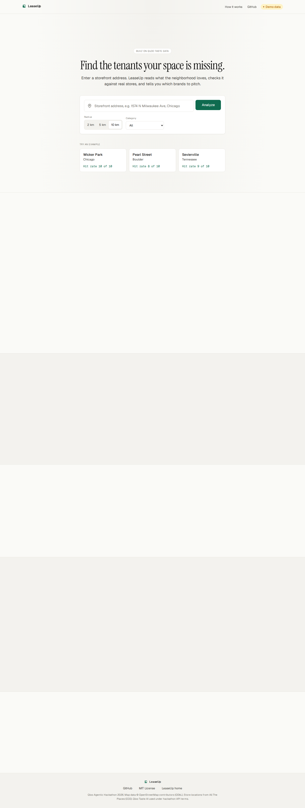
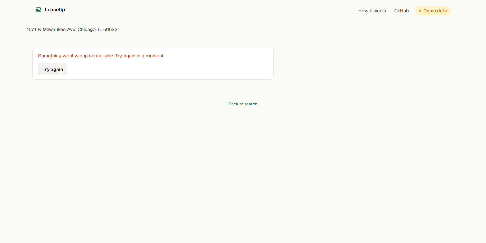
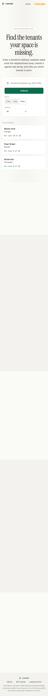
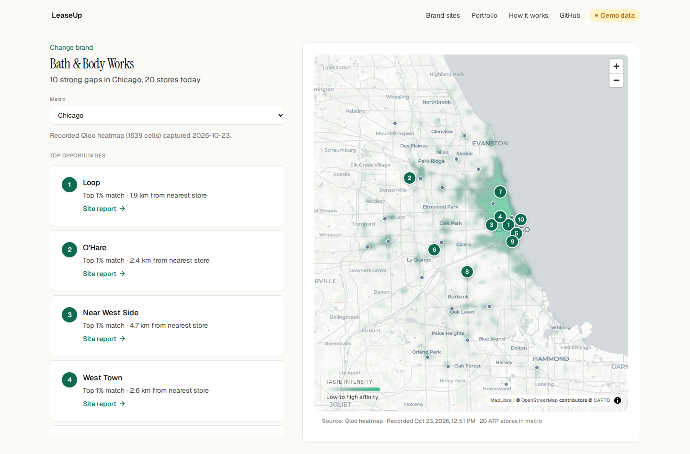
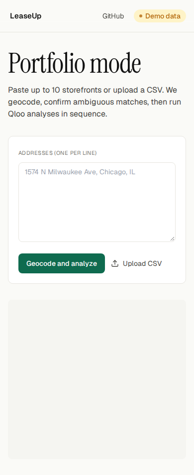
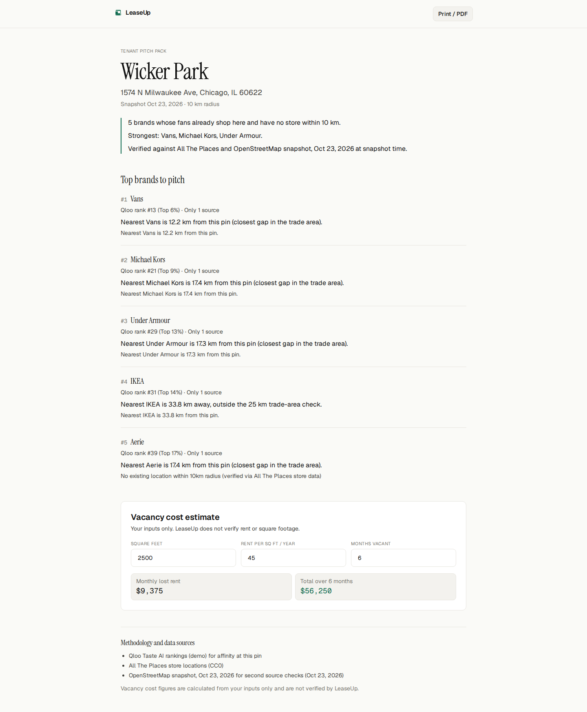
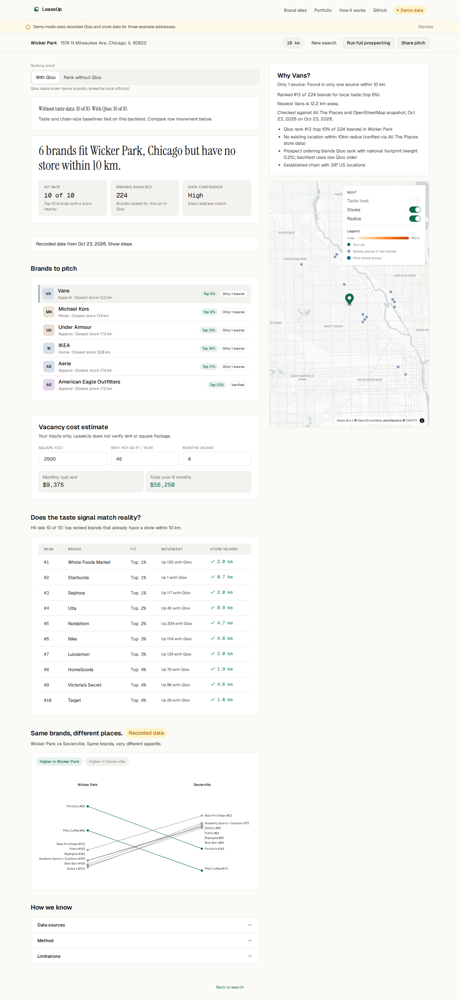
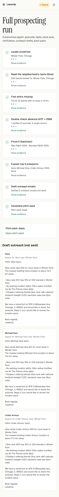
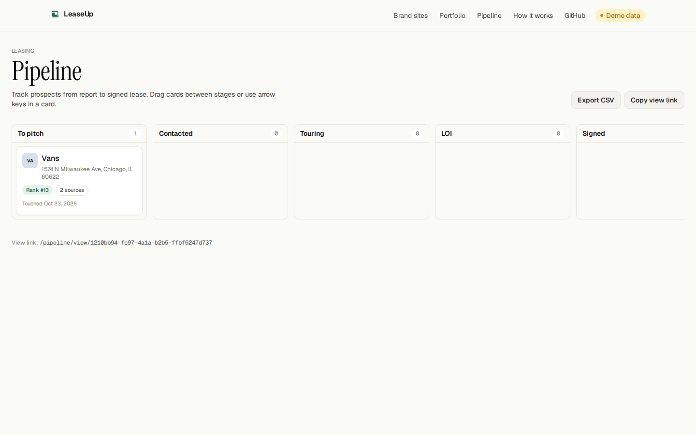
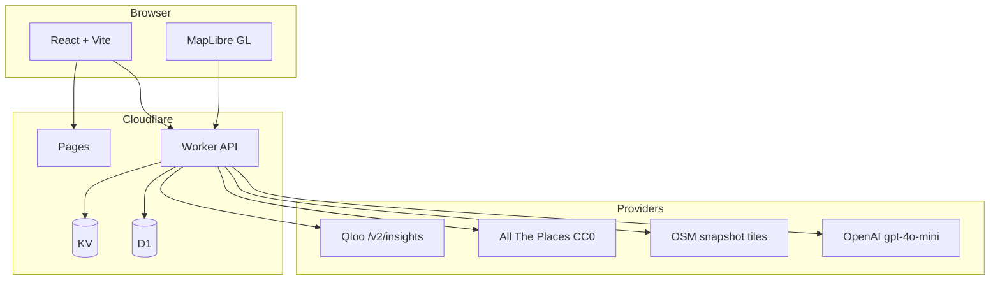

# LeaseUp

**Find the right stores for your empty retail space.**

Type in an address. LeaseUp shows which brands people nearby love but can't find close by, and helps you pitch them. Store locations are checked against public map data before you reach out. Built for the [Qloo Agentic Hackathon 2026](https://qloo.devpost.com/).

**Live demo:** [https://leaseup-59m.pages.dev](https://leaseup-59m.pages.dev)



## Try it in 60 seconds (judge path, demo mode)

Three recorded addresses (no API key): **`1560 N Milwaukee Ave, Chicago, IL 60622`** (Wicker Park chip), **`1300 Pearl St, Boulder, CO 80302`**, **`125 Collier Dr, Sevierville, TN 37862`**. Source: `packages/fixtures/src/demo-addresses.ts`.

| Goal | Minimal path from `/` |
| --- | --- |
| **Finished report** | 1 click: **Wicker Park, Chicago** demo chip |
| **Pitch pack** | On report: **Share pitch pack** → **Create public link** → open pitch URL |
| **Pipeline board** | On report: **Add to pipeline** → **Pipeline** in the header |

Stills for reviewers (no video): [report](docs/screenshots/report-light-1440.png), [pitch](docs/screenshots/features/pitch-pack-light-1440.png), [pipeline](docs/screenshots/features/pipeline-light-1440.png). Full feature-to-criteria map with eval file links: [docs/devpost/SUBMISSION.md](docs/devpost/SUBMISSION.md#judge-path-try-the-product--where-to-verify). Broker Qloo explainer in the app: `/methodology/qloo` (linked from [methodology](https://leaseup-59m.pages.dev/methodology)).



Mobile landing:



## Features

| Feature | What you get |
| --- | --- |
| Taste-ranked prospects | Qloo `/v2/insights` at your pin (or recorded fixtures in demo) |
| Backtest strip | How many top-10 brands already have a store in radius |
| Map + verification | ATP locations and OSM checks on demo recordings |
| Compare mode | Side-by-side neighborhoods from saved Qloo JSON |
| Outreach drafts | OpenAI `gpt-4o-mini` when you click, not by default |
| **Brand sites** (`/brand`) | Qloo heatmap by chain and metro, ATP store overlay, ranked white-space cells |
| **Portfolio** (`/portfolio`) | Batch up to 10 addresses, confirm geocodes, sequential analyses, shareable CSV |
| **Pitch pack** (`/pitch/:id`) | Shareable read-only snapshot from a site report, map image, top 5 prospects, print/PDF |
| **Qloo proof** (report) | Toggle Qloo vs national chain-size baseline with computed backtest comparison |
| **Full prospecting** (`/prospect/:id`) | Agent timeline over SSE: geocode through pitch pack and draft outreach |
| **Leasing pipeline** (`/pipeline`) | Kanban board (D1 + workspace cookie): drag stages, notes, follow-ups, user-set outreach status, grounded outreach drafts, CSV export, read-only share link |
| **Format fit** (report) | Storefront sq ft filter hides big-box prospects (e.g. IKEA); co-tenancy mix by category |

Brand reverse (recorded Chicago heatmap, light 1440px):



Portfolio batch (light 390px):



Pitch pack (light 1440px):



Qloo proof on report (light 1440px):



Autonomous prospecting (light 390px):



Leasing pipeline (light 1440px):



## Architecture



More detail: [docs/ARCHITECTURE.md](docs/ARCHITECTURE.md)

## How we use Qloo

Live requests go to `https://hackathon.api.qloo.com` (override with `QLOO_BASE_URL`):

- **`GET /v2/insights`** with `filter.type=urn:entity:brand`, geocoded `signal.location` (WKT point) and `signal.location.radius` in meters, `take` up to 50, optional `filter.results.entities` (batched at 45 IDs) and `filter.tags`, plus `feature.explainability=true`.
- **Heatmap** uses the heatmap variant on the same API when cells are returned (live only; demo does not fabricate heatmaps).

Demo mode serves recorded responses for the three chip addresses only; other addresses require `APP_MODE=live` and `QLOO_API_KEY`.

## Accuracy and honesty

- **Backtest:** Among brands Qloo returns that we also track in All The Places, we count how many of the top 10 already have a store within your radius. Demo hit rates on the homepage are computed from fixtures (`packages/fixtures`), not hand-edited.
- **40-address live eval (Oct 2026, OSM-retiled ground truth):** raw Qloo **P@10 0.54**, chain size **0.76**, logistic blend **0.825** (**+6.5** pp vs chain), same-size tier AUC **0.664** [0.642, 0.687]. Raw Qloo does not beat chain size on mean top-10 presence. Write-up: `data/qloo-eval-40/QLOO_LIFT_EVAL.md`.
- **Verification labels** on the report reflect ATP matches and OSM snapshot checks where recorded; single-source rows are marked accordingly.
- **Limits:** We track on the order of 200 major chains in the embedded ATP snapshot, not every retailer. Cross-batch Qloo affinity ordering is an assumption when more than 45 brand IDs are requested. Heatmaps appear only when Qloo returns cells in live mode.

Regenerate the metrics table from code:

```bash
node scripts/generate-readme-metrics.mjs
```

## Local setup

Requirements: Node 22+, pnpm 9+.

```bash
pnpm install
pnpm dev          # web + worker via turbo
# or
pnpm --filter @leaseup/web dev
pnpm --filter @leaseup/worker dev
```

Copy `apps/worker/.dev.vars.example` to `.dev.vars` for live Qloo and OpenAI keys. Default `APP_MODE=demo` works without keys for the three demo chips.

Production build:

```bash
pnpm verify:ci
```

## Tests

```bash
pnpm test
```

Web UI copy is checked for em/en dashes. Fixture backtests and demo chip routing have focused tests under `apps/web/src/__tests__/`.

## Screenshots (for reviewers)

Captured with `node scripts/story-screenshots.mjs` after `pnpm --filter @leaseup/web build && pnpm --filter @leaseup/web preview`. Metadata: `docs/screenshots/capture-meta.json` (commit SHA and base branch SHA at capture time).

## License

MIT. See [LICENSE](LICENSE).

## Attribution

- [Qloo](https://qloo.com/) Taste AI (hackathon API)
- [All The Places](https://www.alltheplaces.xyz/) store locations (CC0)
- [OpenStreetMap](https://www.openstreetmap.org/copyright) contributors (ODbL)
- Map tiles via [MapLibre GL](https://maplibre.org/)
