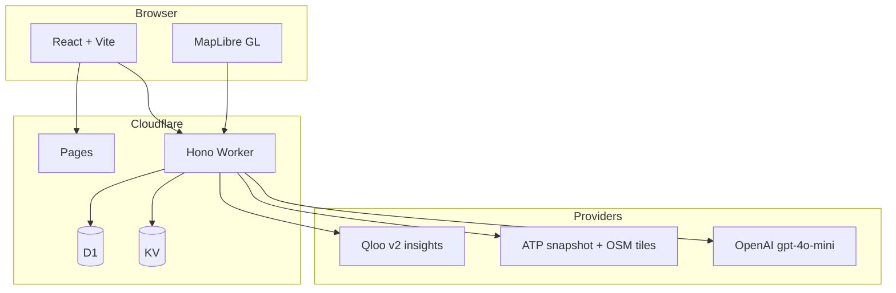

# LeaseUp

Find the right retail tenants for an empty storefront, with taste signals and store-footprint checks before you pitch.

**Live app:** https://leaseup-59m.pages.dev · **Sample pitch brief:** https://leaseup-59m.pages.dev/pitch/demo-boulder-ulta · **License:** MIT


## Try it in two minutes

1. Open the live app. No login or key needed.
2. Click a demo chip (Wicker Park, Boulder, Sevierville). These replay recorded data and are marked **Recorded demo**.
3. Or type any US storefront address, for example `240 Bedford Ave, Brooklyn, NY 11249`. That runs live Qloo calls on the server (30 to 90 seconds cold).
4. Click **Run full prospecting** for the agent run: planner steps, the review after ranking, and the Agent receipt.

Live analyze is capped at **48 cold addresses per UTC day** so the free tiers last; cached addresses do not count. If you hit the cap, use a chip or come back after the UTC day rolls over.

## Problem and audience

Landlords and retail brokers lose time pitching chains that already operate near a site, or that do not match how people shop in the trade area. LeaseUp is for **US retail leasing teams** (landlords, tenant reps, and small-shop brokers) who need a shortlist they can defend: ranked brands, map context, verification notes, and shareable artifacts for owners and prospects.

## What it does

Enter a US storefront address and trade-area radius. LeaseUp returns a **ranked prospect list**, a **report** with funnel and methodology context, and tools to act on that list:

| Area | What you get |
| --- | --- |
| **Site report** | Summary stats, prospect funnel, top brands to pitch, map, trade-area shopper tags, co-tenancy context, optional vacancy cost inputs |
| **Brand pages** (`/brand/:id`) | Chain-level heatmap and gap-style exploration (not used to rank the site pitch list) |
| **Portfolio** (`/portfolio`) | Batch up to 10 addresses, geocode confirm, sequential analyzes |
| **Pitch pack** (`/pitch/:id`) | Read-only leasing brief and share link |
| **Pipeline** (`/pipeline`) | Kanban cards with status, notes, reminders, and evidence links back to the report |
| **Watchlist** (`/watchlist`) | Saved addresses with change alerts |
| **Full prospecting** (`/prospect/:id`) | Multi-step run from geocode through pitch pack, with an **Agent receipt** after completion (logged steps only, JSON/Markdown export) |

**Production** runs the Worker with `APP_MODE=live` (`GET /api/health` reports `mode: live` and Qloo configured). Typed US addresses call Qloo `/v2/insights` on the server, never in the browser, under `LIVE_QLOO_JUDGE_DAILY_CAP` (default 48 cold analyzes per UTC day, `apps/worker/src/lib/live-qloo-judge-quota.ts`). The three demo chips (`packages/fixtures/src/demo-addresses.ts`) replay committed recordings so they stay fast and reproducible. The committed `apps/worker/wrangler.toml` sets `APP_MODE = "demo"` for local work; production sets live in its deploy config (see `docs/DEPLOY.md`).

## Screenshots

Captured from production (deploy50) on Oct 26, 2026 with `scripts/capture-devpost-gallery-3x2.mjs`. All twelve, with captions, are listed in [docs/devpost/GALLERY_ASSETS.md](docs/devpost/GALLERY_ASSETS.md).

| | |
| --- | --- |
| <br>Live agent run (Brooklyn): the review after ranking, with panel numbers for every decision | <br>Agent receipt: planner decisions and logged steps |
| <br>Pitch brief to share with a prospect | <br>Boulder report |
| <br>Phone width (390 px): report and map | <br>Portfolio batch |
| <br>Leasing pipeline | <br>Methodology |

## How LeaseUp uses Qloo and the agent planner

### Taste ranking (site analyze)

- The worker calls Qloo **`GET /v2/insights`** with brand entities at the geocoded point (`apps/worker/src/providers/qloo.ts`). Batches use up to **45** brand IDs per request across **227** tracked chains.
- **Taste twins:** the site's Qloo scores are matched to the 5 most similar of 40 panel markets, at no extra Qloo cost. On live addresses (not the demo chips) twin share feeds the pitch order; top 10 hits rose from 8.2 to 9.0 of 10 in a leave one site out test (`data/qloo-eval-40/TWIN_RANK_EVAL.md`).
- On demo chips (and whenever twins are unavailable) the pitch order uses a **fitted logistic blend** of Qloo affinity and chain size (`packages/fixtures/src/eval/live-qloo-lift/logistic-coefficients.json`), not raw Qloo order alone. Judges and brokers can compare **Local taste** vs **Chain size** in the report UI.
- If Qloo errors in live mode, analyze **falls back to national chain-size ranking**, sets taste status to unavailable, and shows **`TasteUnavailableBanner`** (`apps/worker/src/lib/qloo-chain-fallback.ts`). Demo chips keep recorded taste JSON.

### Full prospecting planner

On **Run full prospecting**, the worker runs **Plan site checks (agent)** before the standard analyze pipeline (`apps/worker/src/lib/prospecting-agent-planner.ts`):

- **Budget:** at most **6** tool steps, **3** Qloo logical calls, and an **18 s** planner loop timeout (`PROSPECTING_AGENT_MAX_STEPS`, `PROSPECTING_AGENT_MAX_QLOO_CALLS`, `PROSPECTING_AGENT_LOOP_TIMEOUT_MS`).
- **Live** workers with `OPENAI_API_KEY`: **gpt-4o-mini** tool calling inside that step (planner kind **model**; receipt label **Agent**).
- **Demo chips:** deterministic **rule** planner (no OpenAI); receipt label **Rule** for those tool rows.
- If the planner is missing, times out, or fails, the run continues with the **fixed analysis pipeline** (`dag_fallback` on the job). The timeline still shows geocode, taste, store scan, verify, rank, outreach draft, and pitch pack steps.

**Review after ranking:** gpt-4o-mini (live) or a rule (demo chips) may move a brand up only when it trades in comparable markets: its share of the 40 panel markets with a store must be within 10 points of the brand it displaces. The server checks every model call against that rule, overrules calls that break it (labeled **Panel check overruled the model**), and writes the reason with the server's numbers (`apps/worker/src/lib/prospecting-agent-review.ts`). Backtest in `data/qloo-eval-40/REVIEW_JUDGMENT_BACKTEST.md`: +0.200 top 5 hits per market, 95% interval [0.025, 0.375].

The **Agent receipt** lists only steps the server logged (`apps/web/src/components/prospecting/AgentReceipt.tsx`). It is an audit-style summary, not a separate generative narrative.

More detail: [How LeaseUp uses Qloo](https://leaseup-59m.pages.dev/methodology/qloo) in the app and [docs/DEVPOST.md](docs/DEVPOST.md).

## Architecture

**pnpm** workspace with **Turbo** (`apps/web`, `apps/worker`, `packages/contracts`, `packages/fixtures`).

| Layer | Stack |
| --- | --- |
| **Web** | React, Vite, Tailwind, MapLibre GL on Cloudflare Pages |
| **API** | Cloudflare Worker, Hono, D1 (pipeline, prospecting jobs, rate limits), KV (response cache), static assets for store and OSM snapshot tiles |
| **Data** | Qloo insights API, All The Places store index (embedded snapshot), OSM snapshot tiles, optional OpenAI for outreach drafts and live planner |



Deeper notes: [docs/ARCHITECTURE.md](docs/ARCHITECTURE.md).

## Evaluation (40-address study)

Headline metrics are committed in `packages/fixtures/src/eval/live-qloo-lift/aggregates.json` and explained in `data/qloo-eval-40/QLOO_LIFT_EVAL.md`. **P@10** means the share of the top 10 ranked brands that already had a store in the trade area per ATP/OSM at the study radius. It is **not** signed leases or guaranteed whitespace.

| Ranker | Mean P@10 (40 US addresses, adaptive radius) |
| --- | --- |
| Raw Qloo | 0.5375 (tables in eval doc round to 0.54; bootstrap CI in eval doc) |
| Chain size | 0.760 (eval doc: 0.76 [0.71, 0.81]) |
| Logistic blend (shipped default) | 0.825 (eval doc: 0.82 [0.78, 0.87]; +6.5 pp vs chain in `aggregates.json`, CI in eval doc) |

Same-size tier AUC for Qloo vs chain presence: **0.664** with 95% CI **[0.642, 0.687]** in `aggregates.json` (`sameSizeAuc`). Heatmap features did not add ranking lift in that study (`heatmapAddsLift: false`).

## Local setup

**Requirements:** Node 22+, pnpm 9+.

```bash
pnpm install
pnpm dev
```

`pnpm dev` runs the web app and worker via Turbo. You can also run `pnpm --filter @leaseup/web dev` and `pnpm --filter @leaseup/worker dev` separately.

Copy `apps/worker/.dev.vars.example` to `apps/worker/.dev.vars` for local worker secrets. Default **`APP_MODE=demo`** works without keys for the three demo chip addresses.

**Worker environment variable names** (set values locally or in Cloudflare; never commit secrets):

`APP_MODE`, `QLOO_API_KEY`, `QLOO_BASE_URL`, `OPENAI_API_KEY`, `OPENAI_MODEL`, `NOMINATIM_CONTACT`, `ALLOWED_ORIGINS`, `LIVE_QLOO_JUDGE_DAILY_CAP`, `GIT_SHA`, `BUILD_TIME`

**Web build:** `VITE_API_URL` (API origin for production builds). Tests may set `VITE_API_URL_ALLOW_MISSING`.

**CI / local gate:**

```bash
pnpm verify:ci
```

## Tests and CI

- **Unit and integration:** `pnpm test` (Vitest across packages; worker tests include analyze, planner, and receipt helpers).
- **End-to-end:** `pnpm test:e2e` (Playwright; local D1 seed via wrangler).
- **GitHub Actions** (`.github/workflows/ci.yml` on `cursor/**`): lint, typecheck, test, worker bundle dry-run, production build, CSP and Axe e2e, Qloo-down path, pipeline and report smokes, Lighthouse CI, and submission doc checks.

## Deploy (high level)

- **Web:** Cloudflare Pages from `apps/web` (see `apps/web` build and `_headers` for CSP).
- **API:** `pnpm --filter @leaseup/worker deploy` (Wrangler, D1 migrations under `apps/worker/migrations`).
- Operational checklists: [docs/DEPLOY.md](docs/DEPLOY.md), [docs/DEPLOY_CHECKLIST_20.md](docs/DEPLOY_CHECKLIST_20.md).

## Limitations

- **US retail chains panel** (~227 brands), not every tenant type or international retail.
- **Store truth** combines an embedded All The Places snapshot and OSM snapshot tiles; brands missing from both cannot be detected. OSM snapshot coverage is partial versus the full chain list (see methodology in app).
- **Shared live Qloo budget:** production analyze is capped by **`LIVE_QLOO_JUDGE_DAILY_CAP`** (default **48** per UTC day). **Local `APP_MODE=demo`** (wrangler default) accepts only the three chip addresses and always uses recordings; it does not replace production live analyze for arbitrary US addresses.
- **Eval metrics** measure in-trade-area store presence, not lease success or broker conversion.
- **Outreach drafts** use OpenAI only when the broker requests them; nothing is sent automatically.
- **Planner** is a bounded tool loop ahead of a fixed DAG, not an open-ended autonomous agent.

## License

MIT. See [LICENSE](LICENSE).
