# LeaseUp

**Find which retail chains to pitch for an empty storefront, using Qloo taste data, real store footprints, and a small agent that shows its work.**

[](https://leaseup-59m.pages.dev)
[](https://youtu.be/SRpG3FYun3E)
[](https://leaseup-59m.pages.dev/methodology/qloo)
[](LICENSE)

[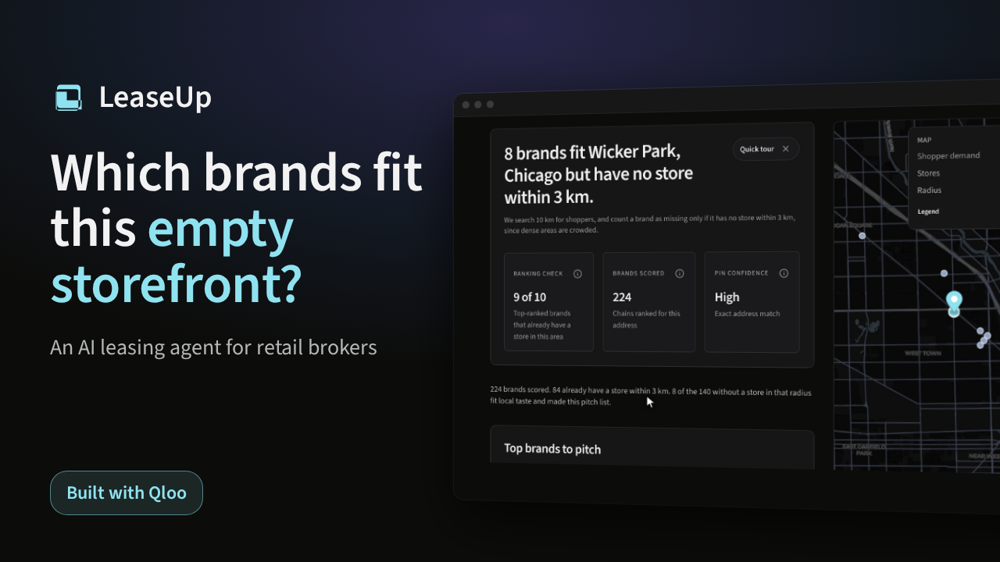](https://youtu.be/SRpG3FYun3E)

**[Live app](https://leaseup-59m.pages.dev)** · **[Demo video](https://youtu.be/SRpG3FYun3E)** · **[How LeaseUp uses Qloo](https://leaseup-59m.pages.dev/methodology/qloo)** · **[Sample pitch brief](https://leaseup-59m.pages.dev/pitch/demo-boulder-ulta)**

Built for the [Qloo Agentic Hackathon 2026](https://qloo-hackathon.devpost.com/). Production is **deploy50** on Cloudflare Pages and Workers (free tiers).

## Try it in 30 seconds

1. Open **https://leaseup-59m.pages.dev**. No login or API key.
2. Click a demo chip (Wicker Park, Boulder, or Sevierville). These replay recorded Qloo and store data, are marked **Recorded demo**, and never use quota.
3. Or type a live US address such as `240 Bedford Ave, Brooklyn, NY 11249` (about 30 to 90 seconds cold).
4. Click **Run full prospecting** for the agent path: planner steps, the review after ranking, and the Agent receipt.

Live analyze is capped at **48 cold addresses per UTC day** so free tiers last through judging. Cached addresses do not count. If you hit the cap, use a chip or come back after the UTC day rolls over.

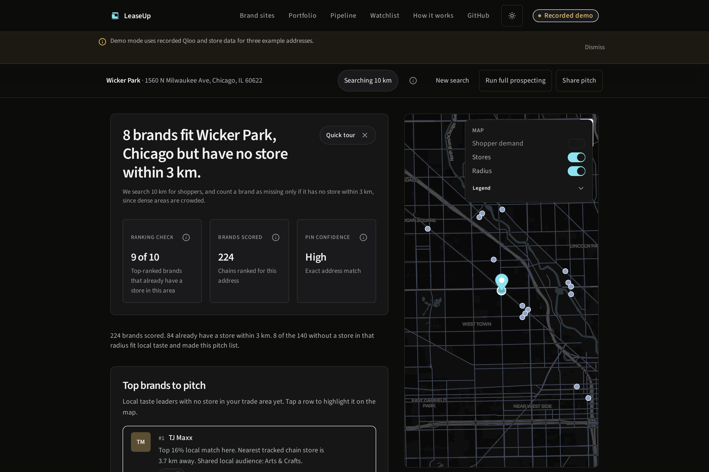

## What it does

LeaseUp turns a US storefront address into a broker-ready shortlist:

| Area | What you get |
| --- | --- |
| **Site report** | Ranked brands to pitch, map, shopper tags, co-tenancy, vacancy cost |
| **Full prospecting** | Bounded agent planner, review after ranking, Agent receipt (JSON/Markdown) |
| **Pitch pack** | Read-only leasing brief you can share |
| **Pipeline** | Kanban with notes, reminders, and evidence links |
| **Portfolio / Watchlist / Brand sites** | Batch addresses, change alerts, chain heatmaps |

Production runs with `APP_MODE=live`. Typed addresses call Qloo `/v2/insights` on the server only. Demo chips replay committed recordings.

## Screenshots

Captured from production (deploy50) on Oct 26, 2026. Full set and captions: [docs/devpost/GALLERY_ASSETS.md](docs/devpost/GALLERY_ASSETS.md).

| Agent review (live Brooklyn run) | Agent receipt |
| --- | --- |
| 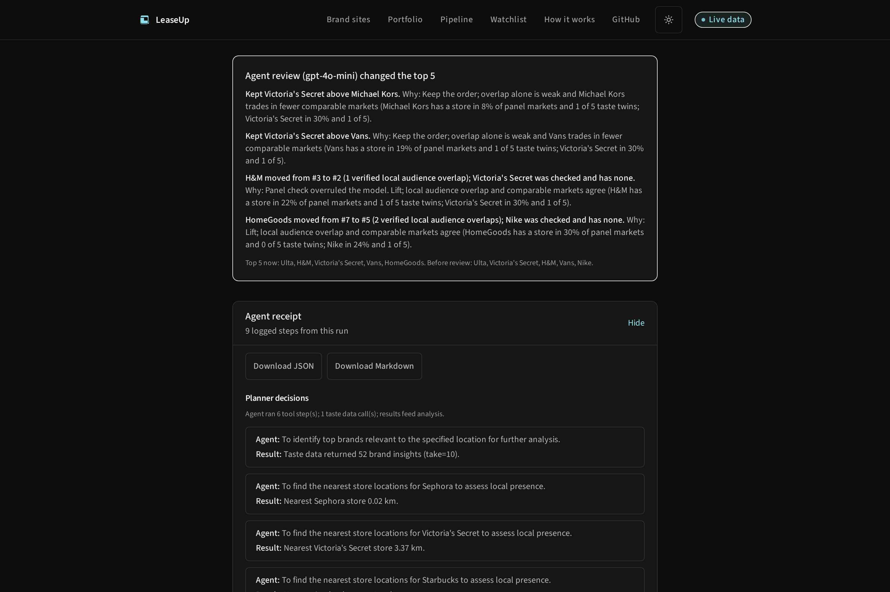 | 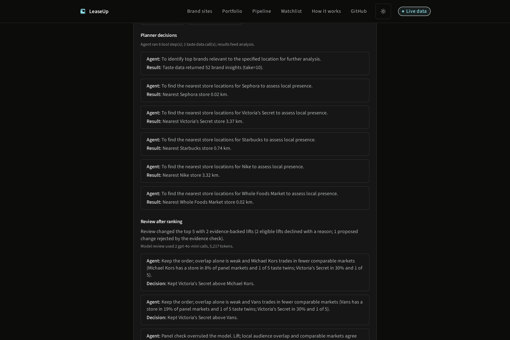 |

| Pitch brief | Boulder report |
| --- | --- |
| 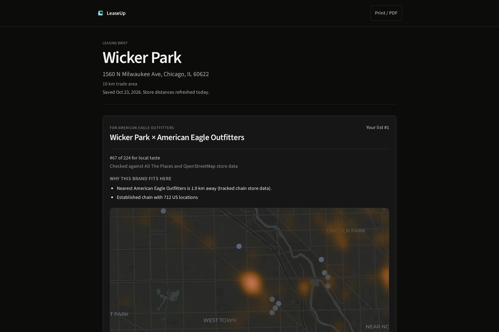 | 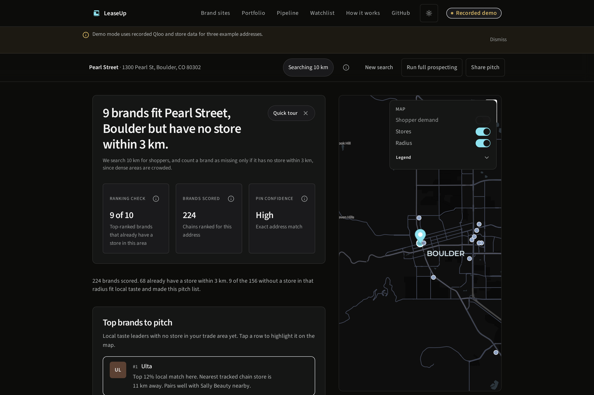 |

| Mobile (390 px) | Pipeline |
| --- | --- |
| 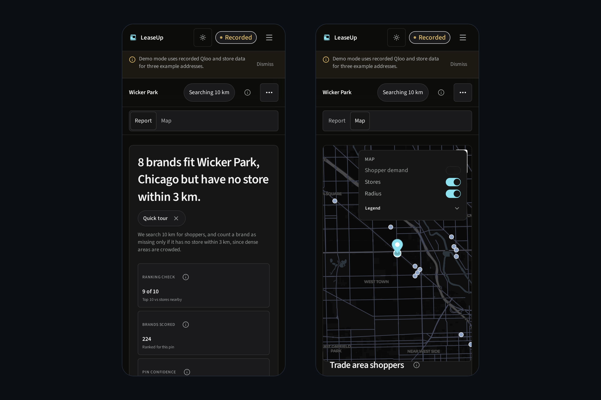 | 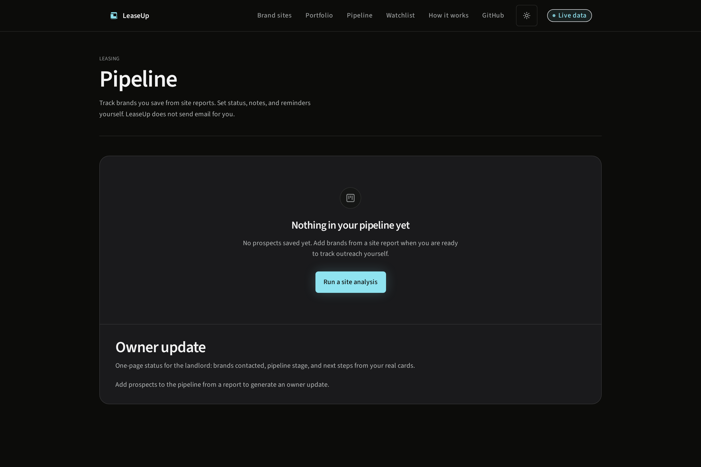 |

| Portfolio | Methodology |
| --- | --- |
| 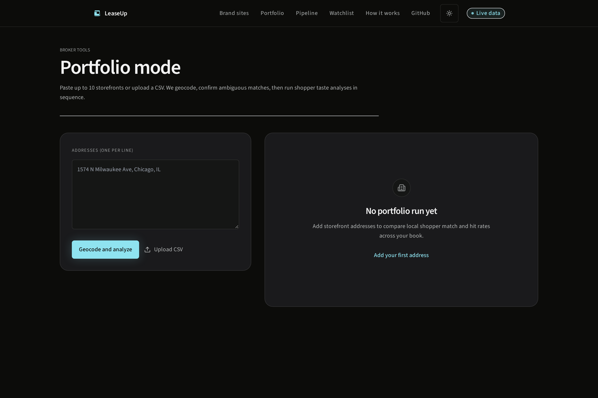 | 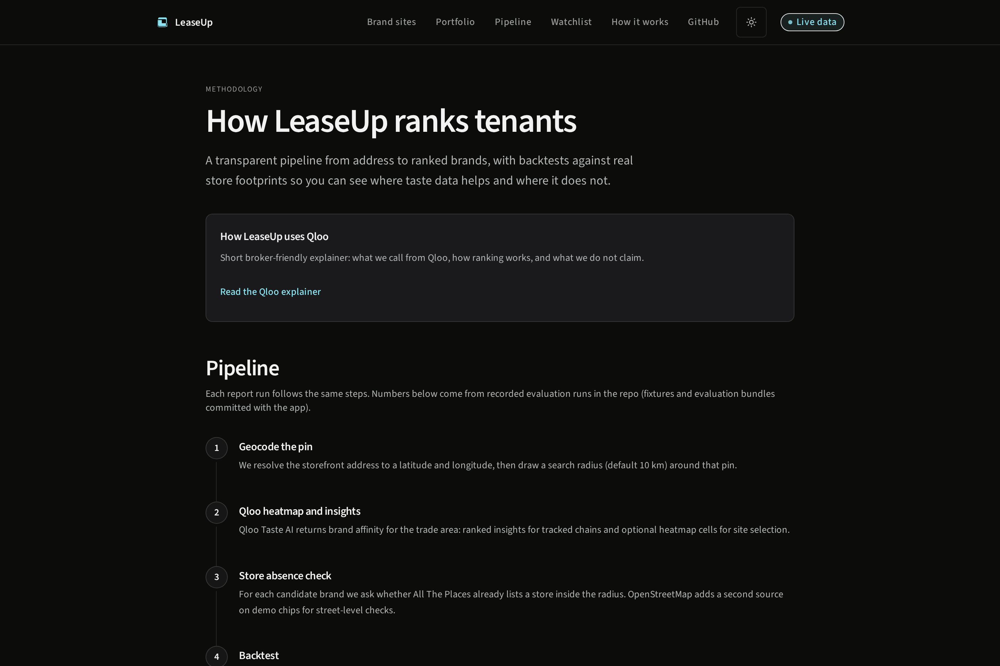 |

## How LeaseUp uses Qloo

- **Brand ranking:** the Worker calls Qloo `GET /v2/insights` with brand entities at the geocoded point (batches of up to **45** IDs across **227** tracked chains). Affinity is blended with chain size in a model fitted on a 40-address live study.
- **Who shops here:** separate location tag insights describe the trade area (shown as names, not raw affinities).
- **Taste twins:** the site's scores are matched to the 5 most similar of 40 panel markets at **no extra Qloo cost**. On live addresses, twin share feeds the pitch order.
- **Agent tools:** the planner and reviewer call the same Qloo tools inside a fixed budget (at most 6 tool steps, 3 Qloo calls, 18 s).
- **Fallback:** if Qloo errors in live mode, ranking falls back to national chain size and the report says taste is unavailable.

In-app explainer: [How LeaseUp uses Qloo](https://leaseup-59m.pages.dev/methodology/qloo).

### Agent review (honest scope)

After ranking, **gpt-4o-mini** (live) or a rule (demo chips) may move a brand up only when comparable-market evidence backs it: the lower brand's share of the 40 panel markets with a store must be within 10 points of the brand it displaces. The server checks every model call against that rule, overrules calls that break it (labeled **Panel check overruled the model**), and writes reasons with the server's numbers. The Agent receipt lists only steps the server logged.

## Measured results (40-address study)

Headline metrics are committed in `packages/fixtures/src/eval/live-qloo-lift/aggregates.json` and explained in `data/qloo-eval-40/QLOO_LIFT_EVAL.md`. **P@10** is the share of the top 10 ranked brands that already had a store in the trade area per All The Places / OpenStreetMap. It is **not** signed leases.

| Ranker | Mean P@10 (40 US addresses) |
| --- | --- |
| Raw Qloo affinity | **54%** (exact 0.5375) |
| National chain size | **76%** (0.760) |
| Fitted logistic blend (shipped) | **82.5%** (0.825; +6.5 pp vs chain, 95% CI 3.3 to 9.3) |

Other committed results:

- Same-size tier AUC for Qloo vs presence: **0.664** [0.642, 0.687]
- Mid-size tier P@5: **0.53** (Qloo) vs **0.23** (chain)
- Taste-twin ranker on live addresses: top 10 hits **8.2 → 9.0** of 10 in leave-one-site-out (`TWIN_RANK_EVAL.md`)
- Review rule leave-one-out: **+0.200** top-5 hits per market [0.025, 0.375] (`REVIEW_JUDGMENT_BACKTEST.md`)

## Architecture

pnpm + Turbo monorepo (`apps/web`, `apps/worker`, `packages/contracts`, `packages/fixtures`).

| Layer | Stack |
| --- | --- |
| **Web** | React, Vite, Tailwind, MapLibre GL on Cloudflare Pages |
| **API** | Cloudflare Worker, Hono, D1, KV, static store/OSM tiles |
| **Data** | Qloo Taste AI, All The Places, OpenStreetMap, OpenAI gpt-4o-mini |

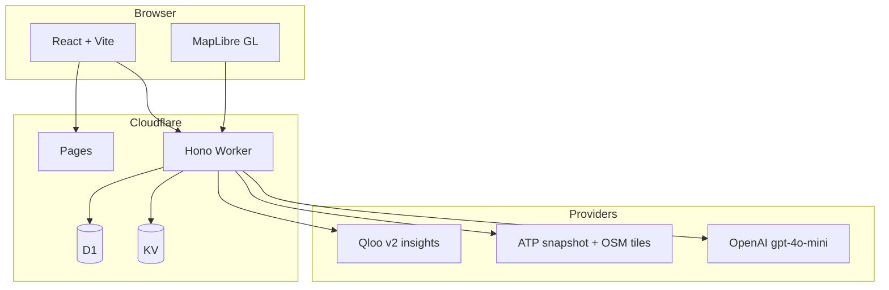

More detail: [docs/ARCHITECTURE.md](docs/ARCHITECTURE.md).

## Local setup

**Requirements:** Node 22+, pnpm 9+.

```bash
pnpm install
pnpm dev
```

Copy `apps/worker/.dev.vars.example` to `apps/worker/.dev.vars`. Default `APP_MODE=demo` works without keys for the three demo chips.

Worker env names (never commit secrets): `APP_MODE`, `QLOO_API_KEY`, `QLOO_BASE_URL`, `OPENAI_API_KEY`, `OPENAI_MODEL`, `NOMINATIM_CONTACT`, `ALLOWED_ORIGINS`, `LIVE_QLOO_JUDGE_DAILY_CAP`, `GIT_SHA`, `BUILD_TIME`.

```bash
pnpm verify:ci
```

## Tests and CI

- **Unit / integration:** Vitest across packages (361 worker tests, 192 web tests at last count)
- **End-to-end:** Playwright (CSP, accessibility, Qloo-down, pipeline, ranking toggle)
- **GitHub Actions** on `cursor/**`: lint, typecheck, test, bundle dry-run, production build, Lighthouse CI (mobile medians: landing perf **93**, report perf **89**, report a11y **96**), submission doc checks

## Limitations

- US retail panel of about **227** chains; not every tenant type or international retail
- Store truth is an All The Places snapshot plus OSM tiles; brands missing from both cannot be detected
- Shared live Qloo budget: **48** cold analyzes per UTC day by default
- Eval metrics measure in-trade-area store presence, not lease outcomes
- Outreach drafts are never sent automatically
- The planner is a bounded tool loop ahead of a fixed pipeline, not an open-ended autonomous agent

## License and credits

MIT. See [LICENSE](LICENSE).

Demo video credits (voice, music, fonts, footage): [docs/devpost/VIDEO_CREDITS.md](docs/devpost/VIDEO_CREDITS.md).

Devpost paste pack: [docs/devpost/SUBMISSION_PACK.md](docs/devpost/SUBMISSION_PACK.md).
