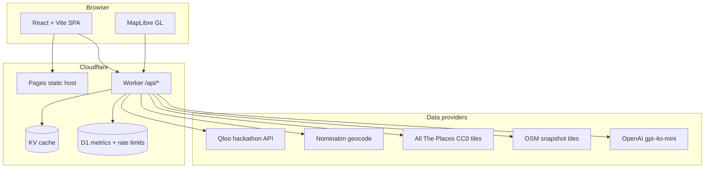

# LeaseUp architecture

LeaseUp is a single-page web app on Cloudflare Pages plus a Cloudflare Worker API. Demo mode replays recorded Qloo and Overpass responses; live mode calls Qloo, geocodes with Nominatim, and verifies stores from static All The Places tiles and optional OSM snapshot tiles.

## System diagram

## Request flow (analyze)

1. **Geocode** storefront text to lat/lon (Nominatim, cached in KV).
2. **Insights** `GET /v2/insights` on Qloo with `filter.type=urn:entity:brand`, location point + radius, optional `filter.results.entities` batches (max 45 IDs per request) and `filter.tags`.
3. **Backtest** rank against ATP store presence inside the search radius (fixtures use the same logic offline).
4. **Prospects** blend national footprint prior, filter to brands missing nearby, verify with ATP + OSM where recorded.
5. **Outreach** optional `gpt-4o-mini` draft when the user requests it (not auto-sent).

## Demo vs live

| Mode | Qloo | Stores | Overpass |
| --- | --- | --- | --- |
| Demo (`APP_MODE=demo`) | Recorded JSON for Wicker, Boulder, Sevierville | Embedded ATP snapshot | Recorded Overpass where available |
| Live | Real `/v2/insights` + optional heatmap | Geohash tiles in worker `public/tiles/` | Live Overpass with fallbacks |

## Repo layout

| Path | Role |
| --- | --- |
| `apps/web` | UI, MapLibre report, landing |
| `apps/worker` | Hono API, providers, D1 migrations |
| `packages/contracts` | Zod schemas shared by web and worker |
| `packages/fixtures` | Recorded Qloo responses, ATP embed, backtest helpers |
| `scripts/` | Tile build, brand assets, README metrics |

## Qloo endpoints used

Base URL default: `https://hackathon.api.qloo.com`

- `GET /v2/insights` with `signal.location` (WKT point) and `signal.location.radius` (meters), `take` up to 50, `feature.explainability=true`.
- `GET /v2/insights` heatmap variant when live heatmap cells are requested (same host, heatmap filter params via `applyQlooHeatmapLocationParams`).

See `apps/worker/src/providers/qloo.ts` and `qloo-location.ts` for parameter wiring.
